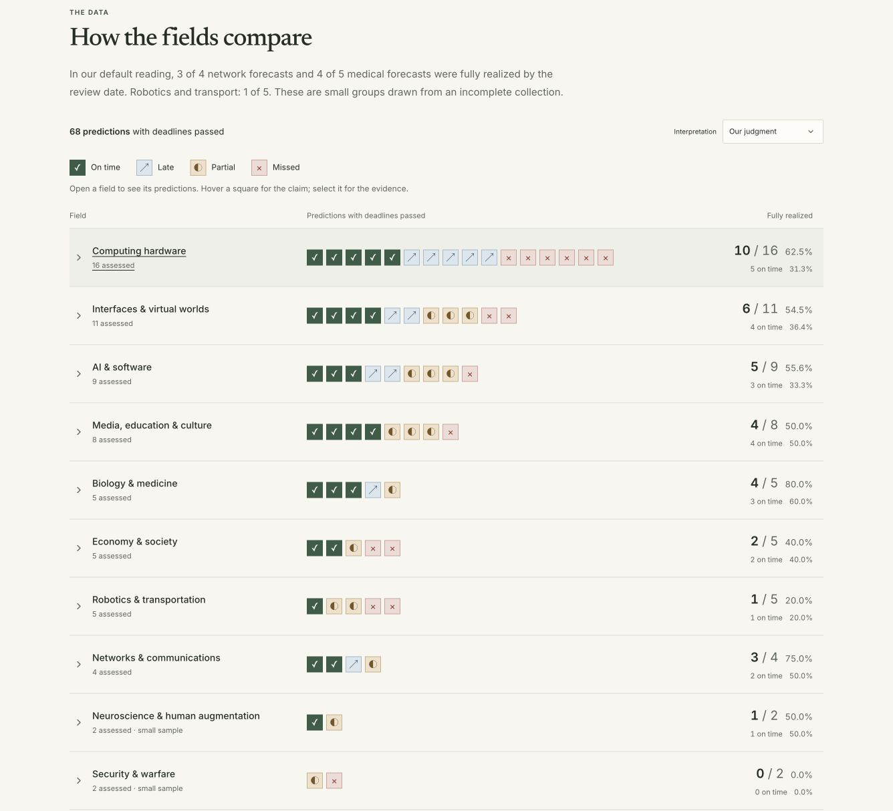

# The Kurzweil Scorecard

Which of Ray Kurzweil's predictions came true—and in which fields? This interactive scorecard compares 84 forecast versions, distinguishes outcomes at the original deadline from what happened later, and shows the evidence behind each judgment.

The starting point is a comparison across fields. Open a prediction to read its evidence without leaving the chart, or use the ledger to search, filter and export the records.



_One square per assessed forecast. The screenshot shows part of the field comparison under the default interpretation._

## What this collection measures

This is a selected, incomplete collection—not a measure of Kurzweil's lifetime accuracy. The judgments are AI-assisted editorial assessments, with alternative interpretations where the wording is ambiguous. Original book editions still need independent checking.

At the **October 15, 2026** research cutoff, the default reading includes 68 forecasts whose deadlines have passed: **25 on time, 11 late, 16 partial and 16 missed**. Fourteen future forecasts and two undated records stay outside that denominator. Partial outcomes receive no fractional credit. All 88 original research leads and earlier assessments remain available as history.

The site includes:

- Expandable comparisons across 13 fields, with counts and percentages.
- Evidence panels with criteria, source links, timing and alternative readings.
- A searchable ledger with shareable filters, CSV export and stable record URLs.
- The original intake, versioned research packages and assessment history.

## Run locally

Requires **Node.js 22+** and **Python 3**. No API keys, database or backend account are needed. Fonts are bundled locally.

```sh
npm ci
npm run data:import
npm run dev
```

Open **http://127.0.0.1:3000** or the port printed by Next.js.

For a production build and local preview:

```sh
npm run build
npm run preview
```

This generates and serves `out/`. The application is fully static; search, filters and evidence panels run in the browser. Data changes require a rebuild.

## Check changes

```sh
npm run check                   # data integrity, TypeScript and unit tests
npm run build
npx playwright install chromium # first use
npm run test:browser
```

Browser tests cover navigation, filtering, record history, evidence panels, keyboard behavior, accessibility and mobile layout. Reports stay in ignored `work/`. An existing Chromium can be selected with `PLAYWRIGHT_CHROMIUM_EXECUTABLE_PATH`.

## Deploy

Serve `out/` on a static host with directory-index support. No application server or SPA catch-all rewrite is required.

For hosting beneath a path such as `/sites/kurzweil/`, configure `config/public-site.json`, then run `npm run export:site`. That creates a separate validated bundle under `work/public-build/`. See the [export guide](docs/STATIC_EXPORT.md) for previews, Jekyll compatibility, and the optional copy command. Building does not publish anything.

## Research and contributions

Corrections are welcome. Identify the prediction ID, interpretation, source passage and outcome evidence so a judgment can be checked. See [CONTRIBUTING.md](CONTRIBUTING.md) for the workflow. Preserve original inputs and earlier assessments; research updates belong in dated supplements or new releases.

- [Data and interface reference](docs/REFERENCE.md): populations, interpretations, timing rules, routes and URL filters.
- [Data model](docs/DATA_MODEL.md): schemas and provenance.
- [Research gaps](docs/V03_INTEGRATION_REVIEW.md): unresolved attribution and coverage questions.
- [Maintenance guide](docs/MAINTENANCE.md): architecture, commands and historical decisions.
- [Changelog](docs/CHANGELOG.md): research and interface changes.

Built with Next.js, React, TypeScript, TanStack Table and Zod. Charts use HTML/CSS; the evidence panel uses a native modal dialog.

## License and attribution

Licensed under the [MIT License](LICENSE). Third-party quotations and source materials retain their own rights; the project license does not relicense those works.

An independent project by [Jason Willems](https://www.jasonwillems.com/), not affiliated with Ray Kurzweil.
